# Samjhao

**A private sidekick beside a live cricket watch-along that explains what is happening, and what the creator just said, at the fan's own level.**

*Samjhao* is Hindi for "explain".

> People do not leave because the match is hard. They leave because everyone around them assumes they already know.

**Live demo:** https://samjhao-six.vercel.app (no login, works on any phone)

---

## The fan and the problem

Meet the newcomer. A cousin pulls them into a creator's watch-along with 100,000 people in it. The creator talks fast: "powerplay", "umpire's call", "he's stuck in the death overs". The chat moves faster still. They are not dumb, they were just never taught, and they are far too embarrassed to type "what is a powerplay?" in front of 100,000 strangers. So they nod along, feel lost, and quietly close the app.

## Why this matters for a second-screen watch-along app

A watch-along app lives or dies on whether people come back for the next match. Fans who already know cricket will come back anyway. The fan who is at risk is the newcomer having their first confusing evening. If that first match feels like an inside joke they weren't let in on, there is no second match. Samjhao goes after exactly that moment: it turns every bit of jargon into something they can tap and understand privately, at their own depth, without slowing anyone else down.

## What it does

- **Every jargon word is tappable.** Terms in the commentary have a dotted "ball seam" underline. Tap one and a bottom sheet explains it.
- **It explains the creator, not just the match.** Tap the creator's chat bubble ("That's umpire's call and it HURTS") to see what they actually *meant*. This is the signature feature: the hardest jargon comes from the person talking, not the scoreboard.
- **Three depths.** Beginner (never watched cricket, one everyday analogy), Moderate (knows runs, wickets and overs) and Advanced (the tactical angle). All three state the same facts; only the depth changes. "Show simpler" and "Go deeper" let you peek at another level for one explanation without changing your setting.
- **English or Hinglish.** One tap switches the commentary, the creator lines, the explanations and the interface.
- **A gentle nudge.** When a moment has a word you haven't learned, a small chip offers it once ("Confused? Tap to understand: Powerplay") and then gets out of the way. Nothing ever needs typing.
- **Catch me up.** A 20-second briefing: where the chase stands, what happened in the last few balls, and one thing to watch next.
- **Learned today.** Words you have tapped are collected. Tap one again and you get a one-line reminder first, not the full lecture.
- **The score itself is explained.** Even "RRR" on the scoreboard is tappable, and the pressure meter uses a word and a bar count, never colour alone.

### Screenshots (390 px phone)

| First run | A live moment | Tap a word (Beginner) | Same word, "Go deeper" |
| --- | --- | --- | --- |
| 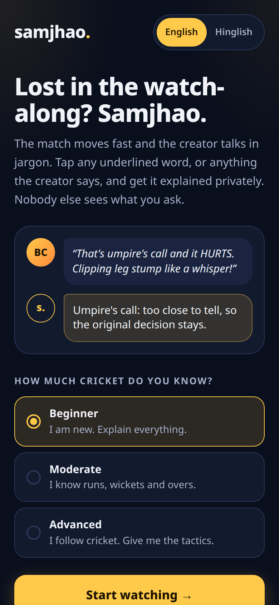 | 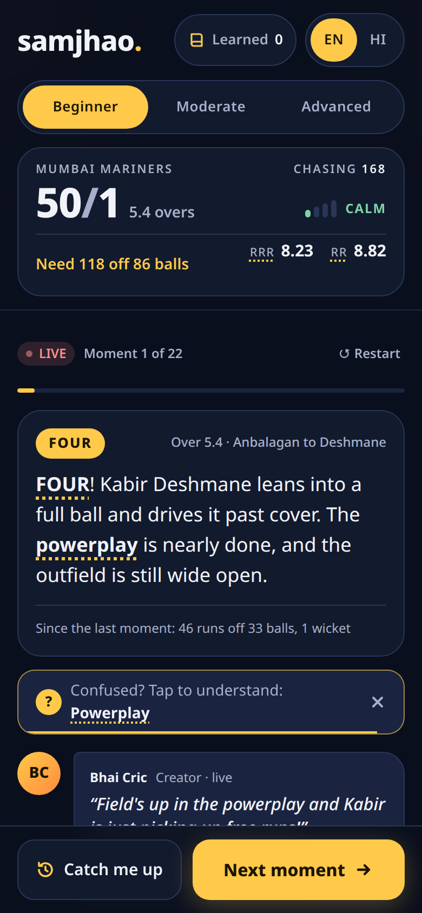 | 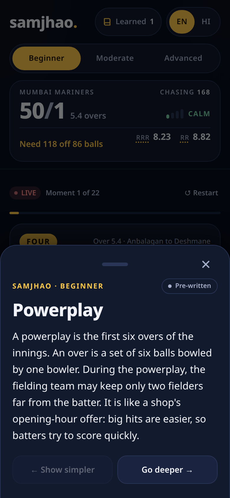 | 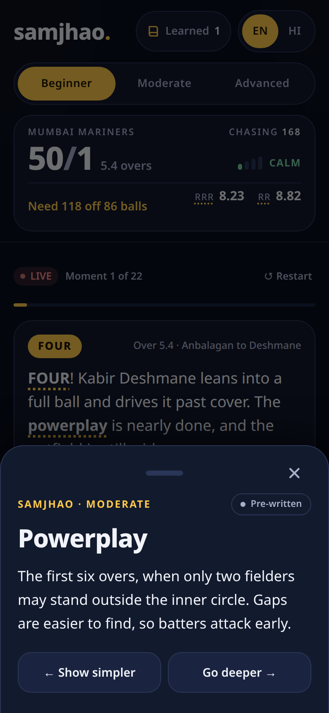 |

| What the creator meant | Hinglish + Advanced | Catch me up | Full time |
| --- | --- | --- | --- |
| 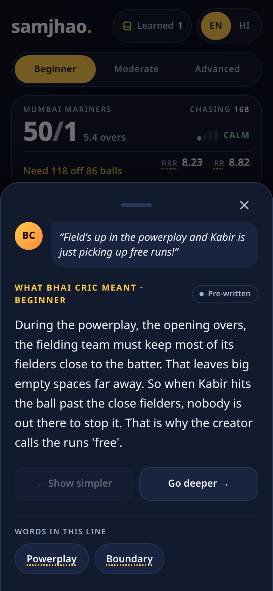 | 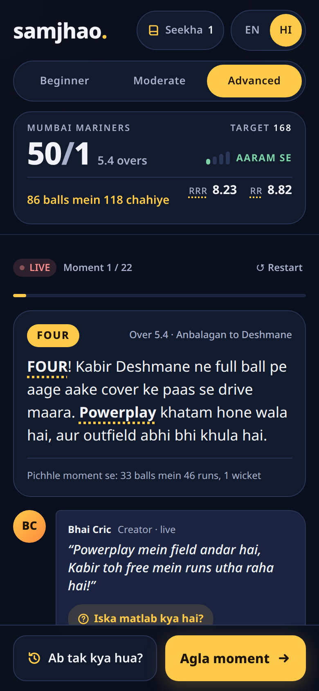 | 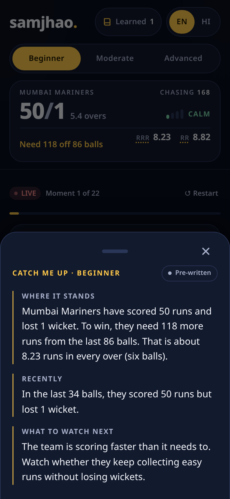 | 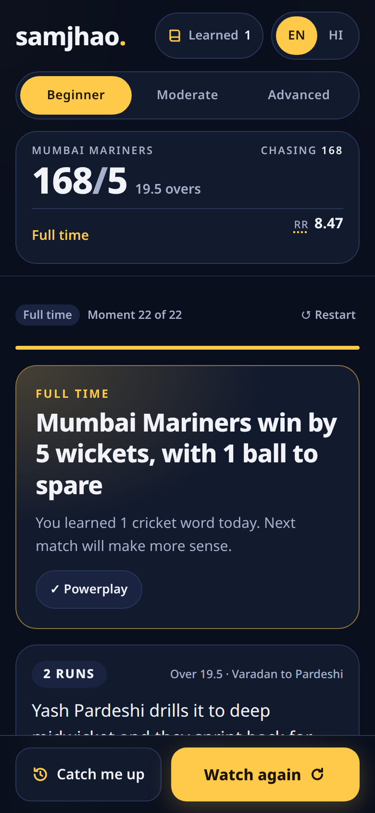 |

| LBW + review + umpire's call | Learned word: reminder first |
| --- | --- |
| 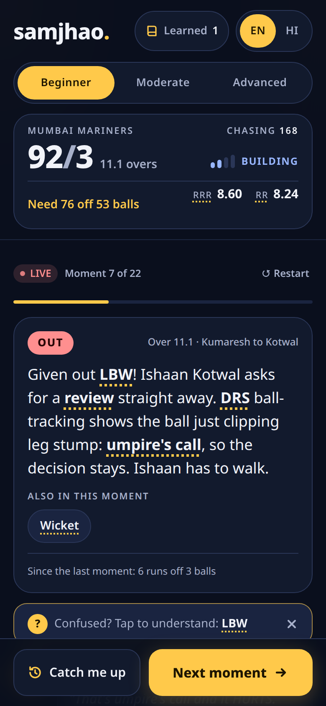 | 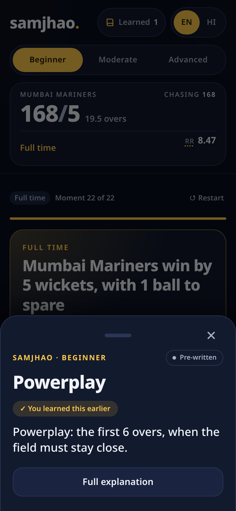 |

### Demo path (five steps)

1. Open the link, pick **Beginner**, tap **Start watching**.
2. Tap the underlined **powerplay**. Read it, then tap **Go deeper** to see the same fact at Moderate.
3. Tap the **creator's bubble** to see what Bhai Cric meant. Tap a word under "Words in this line".
4. Tap **Next moment** a few times (the LBW review at moment 7 is a good one), switch to **HI** for Hinglish, and open **Catch me up**.
5. Step through to the last-over finish, see the result and the words you learned, then open **Learned** and tap a word to see its short reminder.

## Honesty section

| Part | What it really is |
| --- | --- |
| Match data | **Simulated.** A fictional T20 chase (Mumbai Mariners vs Chennai Chargers) told in 22 key moments. All teams, players and the creator "Bhai Cric" are invented. |
| Creator transcript | **Simulated.** 14 creator lines written for this demo, each linked to a moment. |
| Numbers | **Computed**, never written by hand or by an AI. Score, overs, runs needed, run rates, the pressure label and the catch-up numbers all come from pure functions in `src/lib/matchMath.ts`. Between moments, the data stores a small summary of the balls in between (runs, balls, wickets), so the score is still a plain sum. Tests check that every over number in the data matches the computed ball count, and that the moment and creator text contain no digits at all. |
| Explanations | **Pre-written** and reviewed: 18 glossary terms × 3 levels × 2 languages, plus 14 creator lines × 3 levels × 2 languages. Tests enforce the word limits per level. |
| Live AI | **Optional and off on the demo.** `/api/explain` can rephrase an explanation with Anthropic or OpenAI if a key is configured. Every explanation shows a "Pre-written" or "Live AI" label so the demo never overclaims. |
| How it was built | With **Claude Code** (Anthropic's coding agent), following a written brief, then reviewed and tested by me. |

## How it works

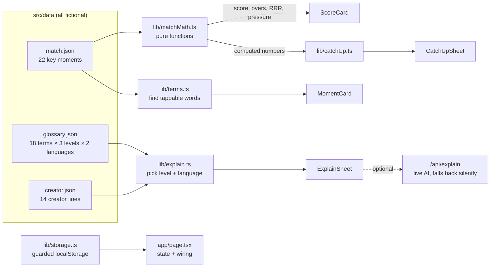

**One screen, one state holder.** `src/app/page.tsx` holds the current moment, level, language, learned words and which sheet is open. Every component just receives props and calls back. There is no state library and no UI library.

### Every number is computed

`src/lib/matchMath.ts` is the only place numbers come from:

| Function | What it does |
| --- | --- |
| `score(events, i)` | Sums runs and wickets up to moment `i`, including the summarised gap before each moment |
| `legalBalls(events, i)` | Counts balls, skipping wides and no-balls (they are bowled again) |
| `oversText(balls)` | 87 balls → `"14.3"` |
| `ballsLeft`, `runsNeeded` | Never below zero |
| `currentRunRate`, `requiredRunRate` | Runs per over, 2 decimals. RRR with runs needed but no balls left is `Infinity`, shown as "–" |
| `lastTwelve(events, i)` | Runs and wickets in the last ~12 balls. If a summarised gap straddles the window, it reports the true ball count instead of inventing a split |
| `pressure(rrr, crr, wickets, ballsLeft)` | `calm` / `building` / `tense` / `desperate`, thresholds documented in the code |

**Pressure thresholds** (kept simple so they are easy to explain):
- **Desperate:** asking rate above 13, or more than 3 above the scoring rate with 7+ wickets down.
- **Tense:** asking rate above 10, or 2+ above the scoring rate, or 6+ wickets down, or the last two overs with runs still needed.
- **Building:** asking rate above the scoring rate at all, or 4+ wickets down.
- **Calm:** otherwise.

### The 18 glossary terms

Powerplay, Boundary, Dot ball, Wicket, LBW, DRS, Review, Umpire's call, Free hit, No ball, Wide, Yorker, Required run rate, Run rate, Strike rate, Economy, Death overs, Run out.

Each one has Beginner (40–70 words, one everyday analogy), Moderate (20–35 words) and Advanced (10–25 words, the tactical angle) explanations in English and Hinglish, plus a one-line reminder. A test fails the build if any English explanation leaves its word range.

### The optional live AI route

`POST /api/explain` with `{ kind, id, level, lang, state }`:

- **No free text in.** Only known ids, an allowed level and language, and numeric match state are accepted. There is no prompt-injection surface.
- **Grounded.** The model gets our reviewed explanation (or the computed numbers) and is told to use only those facts, keep to the word limit, and avoid betting or predictions.
- **Provider-neutral.** `LLM_PROVIDER` = `anthropic` or `openai`, `LLM_MODEL` from env (no model name in the code), plain `fetch`, 8-second timeout.
- **Never fails loudly.** No key, a bad request, rate limit (20/min per IP), timeout, refusal or a non-200 response all return `{ source: 'static' }`, and the screen keeps the pre-written text. The key is never logged or sent to the browser.

## How it was tested

| Check | Result |
| --- | --- |
| Unit tests (Vitest, `npm test`) | 47 passing: match math (zero balls, extras, finished chase, RRR with no balls left, rounding), data integrity (every over.ball matches the computed count, every tag is a real term), word limits, no digits in written text, catch-up only uses computed numbers |
| Full tap-only walkthrough on a 390 px phone (Playwright) | Every feature, all 22 moments, persistence, reset: passing, zero console errors |
| In-app browsers (Instagram iOS, WhatsApp/Android WebView user agents and short viewports), 320 px phone | No overflow, Next button always in thumb reach, sheets scroll |
| localStorage blocked (private mode / locked-down webviews) | Toggles and learned tally still work for the visit |
| Keyboard only | Every control reachable, visible focus, sheets trap focus, Escape closes and returns focus |
| Swipe down / tap outside / Escape | All close the sheet |
| Reduced motion | Animations switched off |
| axe accessibility scan (WCAG 2.1 AA) | 0 violations on every screen, both languages |
| Lighthouse (mobile, on the live site) | Performance 96, Accessibility 100, Best practices 100, SEO 100 (LCP 1.6 s, CLS 0) |
| `/api/explain` without a key, with a fake key, bad input, rate limit | Always `{ source: 'static' }`; key absent from logs, HTML and bundles |

## How a production version would work

- **Live data:** a licensed ball-by-ball feed mapped onto the same `BallEvent` schema used here (`over`, `ball`, `runs`, `isExtra`, `isWicket`, `tags`). The math and UI would not change; only the source would.
- **Tags:** a small rules layer turns feed fields into glossary tags (`isExtra: 'noball'` → `no-ball`, `free-hit`; over ≥ 15 → `death-overs`), and the commentary text comes from the feed.
- **The creator:** speech-to-text on the creator's stream, chunked into lines, with a jargon detector (glossary aliases first, then an LLM) to decide which lines get an "explain" bubble.
- **Explanations:** cached per term × level × language, so the common case is a cache hit with zero latency and zero model cost. Live generation is only for creator lines, which are new every match, and it is grounded on the computed numbers, as `/api/explain` already is.
- **Safety:** a profanity and safety filter on the creator transcript before it is shown or explained, and no betting or prediction language anywhere.
- **Delivery:** explanations pushed with the moment over the same low-latency channel as chat, so the help arrives with the play, not after it.

## Tradeoffs and what I left out on purpose

- **No accounts or database.** The newcomer's first five minutes should not start with a sign-up. Preferences and learned words live in the browser (guarded, so the app still works if storage is blocked).
- **No real live data.** Licensing is real-world work; a simulated, deterministic match makes the demo repeatable and lets every number be tested.
- **No predictions, odds or fantasy picks.** A confused newcomer needs understanding, not a nudge towards money. "What to watch next" describes the situation and never forecasts a result.
- **Taps only.** No chat box, no typing. That keeps the experience private and fast, and removes any prompt-injection surface from the AI route.
- **One sport, one match.** Depth over breadth.

## How I would measure success

- **Second-match return rate for newcomers** who used Samjhao in their first match, compared with those who didn't. This is the number that matters.
- **Terms tapped per session**, and how many sessions have at least one tap. Taps mean the fan is trying to understand, not leaving.
- **Repeat explanations dropping over time:** the same fan tapping "powerplay" in match one but not match three is the clearest sign of learning. The "reminder first" design makes this measurable.
- **Level drift:** fans moving from Beginner to Moderate over a few matches.

## Known limitations and next steps

- Hinglish copy is hand-written and should get a native-speaker review pass at scale.
- The match is fixed; a real version needs the feed integration above.
- Learned words are per device. Syncing them would need an account, which is a deliberate trade.
- The live AI rate limit is in memory per server instance (fine for a demo, not for production).
- Next: a short "first match" tour, explanations for fielding positions ("long-on", "deep midwicket"), and voice playback for the catch-up.

## How to run it locally

Requires Node 20 or newer.

```bash
npm install
npm test          # logic and content tests (Vitest)
npm run dev       # http://localhost:3000
npm run lint
npm run build && npm start
```

Optional live AI: copy `.env.example` to `.env.local` and fill in `LLM_PROVIDER` (`anthropic` or `openai`), `LLM_MODEL` and `LLM_API_KEY`. Without them, the app runs fully on pre-written text.

## Where things are

```
src/
  app/page.tsx              state and wiring for the single screen
  app/api/explain/route.ts  optional live AI, falls back silently
  components/               Header, ScoreCard, MomentCard, CreatorLine, ExplainSheet,
                            CatchUpSheet, Nudge, LearnedTally, Controls, FinishCard,
                            Welcome, Sheet (shared accessible bottom sheet)
  data/                     match.json, creator.json, glossary.json (all fictional)
  lib/matchMath.ts          every number on screen comes from here
  lib/catchUp.ts            the 20-second briefing templates
  lib/explain.ts            picks text by level and language
  lib/terms.ts              finds tappable terms in a moment
  lib/storage.ts            guarded localStorage + persisted state hook
  lib/copy.ts               interface wording in English and Hinglish
```
